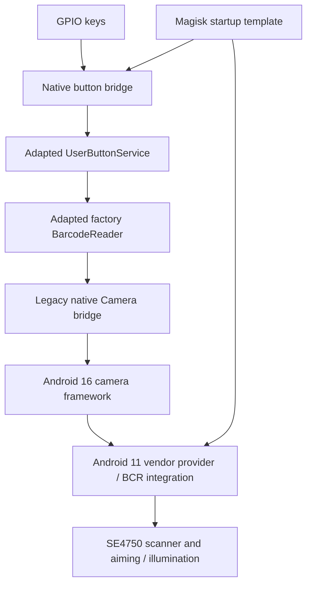

# Architecture and compatibility work

## Legacy native camera calls

The application used old `Camera::connect*` exports. The Android 16 interface required non-trivial return handling through AArch64 x8, target SDK in w1, compatibility data in x2, forceSlowJpegMode in w3, attribution in x4, and device policy in w5. The two call boundaries must be checked independently.

Attribution came from the application's Context via framework Parcel serialization, preserving its identity, token, and next chain. A fabricated package name or a root probe with empty attribution was not equivalent. The scanner ID was preserved rather than rewritten to ordinary camera 0.

Private layouts and symbol addresses are tied to the tested framework libraries. The source is not a stable NDK interface or a portable replacement for libcamera_client.

## Scanner lifecycle

Connection alone did not verify decoding. Repeat scans required correct stop/restart sequencing, backend state handling, and the application's result/history behavior. Selected diagnostic and epoch-gating sources are included as implementation snapshots. They do not constitute a complete rebuild of the final adapted APK or HAL package.

## Buttons

The bridge locates `soc:gpio_keys`, intercepts supported application keys, dispatches down/up events, and passes unrelated keys through a virtual uinput device. Its request queue checks file ownership, type, size, age, and numeric keycode range. This is privileged integration; the checks do not amount to a comprehensive security audit.

## Startup and policy

The module template keeps adapted scanner/diagnostic APKs as data applications and uses the validated privileged overlay for button components. It backs up the old startup hook, stages scanner payloads, starts scanner integration before the buttons, and disarms an interrupted scanner application on the next boot.

SELinux stays enforcing. The supplied rules are narrower than global permissive, but **not exclusive to one package**: they target `untrusted_app_30` and add MLS trusted-object attributes to scanner types. This affects other processes with those types/domains and requires a security review before wider use.

## Wi-Fi

The libcfg patch adds a 44-byte byte-wise comparator and redirects the matching library's memcmp PLT entry. Original-image and structure checks guard the patch. The deployment modifies vendor persistently, while most scanner integration is runtime mounted/configured. Do not describe the complete setup as entirely systemless.
